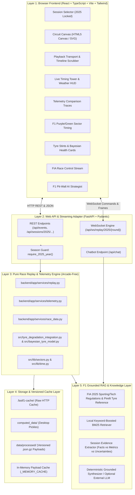
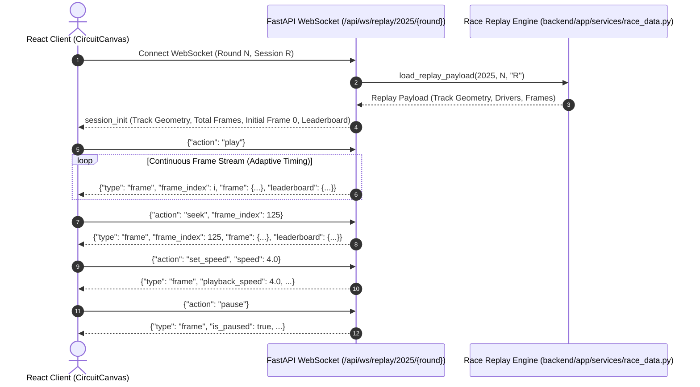
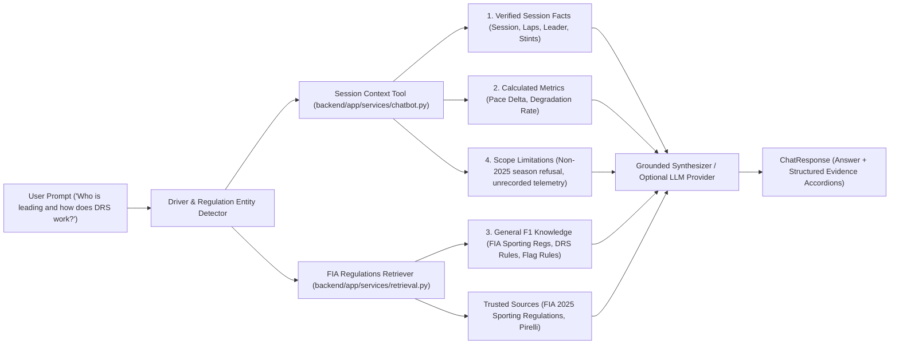

# Formula 1 2025 Web Platform — Architecture & Design

This document details the architecture, component boundaries, data flow, WebSocket streaming protocol, Bayesian tyre model integration, and Grounded AI Chatbot for the Formula 1 2025 Race Replay and Telemetry Analytics web platform.

---

## 1. High-Level Layered Architecture

The application strictly decouples the browser frontend from the underlying data processing and replay engine without removing or breaking the existing desktop code (`main.py`, `src/`).

---

## 2. Replay Streaming Protocol (WebSocket & HTTP Fallback)

The client communicates with the server over WebSocket for zero-latency bidirectional replay streaming, with automatic fallback to local interpolation or chunked HTTP polling.

---

## 3. Grounded F1 Knowledge Chatbot Architecture

To prevent LLM hallucination and adhere strictly to verified session facts, the chatbot employs a 4-tier evidence categorization pipeline:

---

## 4. Centralized 2025 Season Restriction

All entry points enforce the 2025 season lock:
1. **API Router**: Validates `year == 2025` using `require_2025_year()`. Returns HTTP 400 with a descriptive error message if any other year is requested.
2. **WebSocket Route**: Rejects non-2025 seasons immediately with error code 1008 and close event.
3. **Data Loader & Cache Paths**: Keys include the season (`v1_2025_R01_R.json.gz`).
4. **Chatbot Service**: Rejects queries requesting telemetry for other seasons (e.g. 2021, 2024), adding an explicit Season Restriction notice to the response uncertainties.
